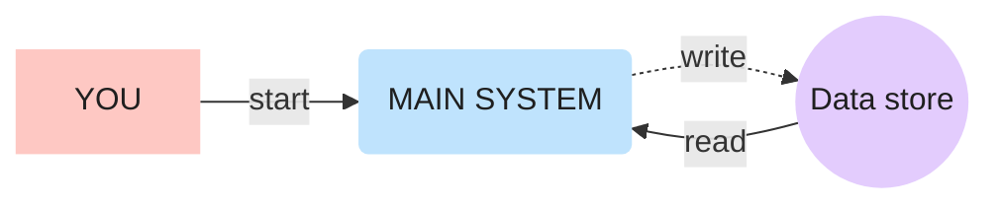

# Visual Diagram

**Only run when the user explicitly asks for this skill** (`/visual-diagram …` or "use the visual-diagram skill"). Never use it on your own for ordinary explanations.

Make **one clear, colourful diagram** of the part the user names (Claude Code passes it as `$ARGUMENTS`; other agents: the rest of the user's message) — a flow, pipeline, architecture, request lifecycle, data model… Default output is a hand-laid-out **SVG** linked from Markdown. If the user says `mermaid`, produce a **styled Mermaid** block instead (see the end).

Style reference: [example-pipeline.svg](example-pipeline.svg) in this folder. Open it and match its look.

## 1. Understand before drawing

1. Read the code/docs for the named part. Diagram what **actually** happens, not a generic picture. If the target is ambiguous, ask one question.
2. List the pieces (≤ 12 shapes; if more, split into two diagrams or group them) and every arrow with a 1–4 word label.
3. Decide the story the eye should follow: usually left → right for the main path, loops drawn around the outside, outputs at the bottom.

## 2. Visual language (keep it consistent)

| Meaning | Shape | Fill |
| --- | --- | --- |
| People, external apps/services | rectangle, `rx="6"` | pink `#FEC8C3` |
| The main system / agent / process | big rounded box, `rx="48–56"` | blue `#BFE3FD` |
| Data stores, records, queues | circles | purple `#E3CCFD` |
| Decisions / warnings (optional) | rectangle | yellow `#FFF1B8` |
| Success / outputs (optional) | rectangle | green `#C9F2D6` |
| A group (e.g. "Notion", "Cloud") | dashed outline `stroke="#9a8fb0" stroke-dasharray="6 6"`, no fill, label on top | — |

- **Solid arrow** = trigger / call / read. **Dashed arrow** (`stroke-dasharray="8 6"`) = write / return / async / later.
- Text: titles 22–28 px bold `#1f1f1f`; sub-labels 14–16 px `#3a3a3a`; arrow labels 16 px, important ones bold.
- Always include: a title + one-line subtitle at the top-left, and a small legend at the top-right (solid vs dashed, colour meanings).
- Numbered steps (①②③) inside the main box when it does several things in order; reuse the numbers on the arrows.
- White background rect covering the whole `viewBox` (so dark-mode viewers still show it).

## 3. Build the SVG

- Canvas: `viewBox="0 0 W H"` with matching `width`/`height`, typically 1600–1700 × 900–1100. Font: `font-family="'Segoe UI', Inter, Helvetica, Arial, sans-serif"`.
- Plan a grid first: write down x/y/width/height for every shape, then compute arrow endpoints on shape **edges** (for circles: `x = cx ± sqrt(r² − (y − cy)²)`).
- Draw **arrows first, shapes after**, so shapes sit on top of line ends.
- Arrowheads via `<marker>` with `orient="auto-start-reverse"`, `refX` at the tip; end the path 2–4 px before the target edge.
- Elbow routes with rounded corners: `H… Q cornerX,cornerY nextX,nextY V…` (12 px radius). Route loops outside the main shapes; never let a line cross through a shape or a label.
- Labels sit above horizontal arrows (y − 10) or beside vertical ones, centred with `text-anchor="middle"`; keep ≥ 8 px from any line or shape.
- GitHub-safe SVG only: no `<script>`, no `<foreignObject>`, no external fonts/images/CSS imports, no `<style>` with `@import`. Plain shapes, paths, text, markers.
- Save next to the docs it explains (e.g. `docs/diagrams/<name>.svg` or beside the `.md`), kebab-case name. **Don't overwrite an existing diagram without asking.**
- Link it from the relevant Markdown: `` plus one line saying what solid/dashed mean if there's no legend.

## 4. Verify by looking (mandatory)

Render it and look at the picture before showing the user:

```bash
# Windows (Edge) — adjust size to the viewBox
"/c/Program Files (x86)/Microsoft/Edge/Application/msedge.exe" --headless=new --disable-gpu --hide-scrollbars \
  --window-size=1640,1060 --screenshot="<scratch>/check.png" "file:///<absolute path>/<name>.svg"
# macOS/Linux: same flags with google-chrome / chromium / "Google Chrome.app"
```

Open the PNG (Read tool) and check: no overlapping text, every arrow starts and ends on an edge with its head visible, no line crosses a shape or label, labels readable, legend correct. Fix and re-render until clean. Put the PNG in the scratchpad/temp folder, never in the repo.

## 5. Mermaid variant (when the user asks for `mermaid`)

Use the same palette so it still looks related:



Shapes: `[rect]` people/apps, `(rounded)` main system, `((circle))` data, `{decision}`; `-->` solid, `-.->` dashed; `subgraph` for groups. Tell the user the trade-off once: Mermaid auto-places shapes, so it's quicker to edit but can't match the hand-placed SVG layout.

## 6. Hand-off

Tell the user where the file is, where it's linked, and what each colour/arrow style means — in 2–3 lines. Offer one obvious improvement only if there is one.
